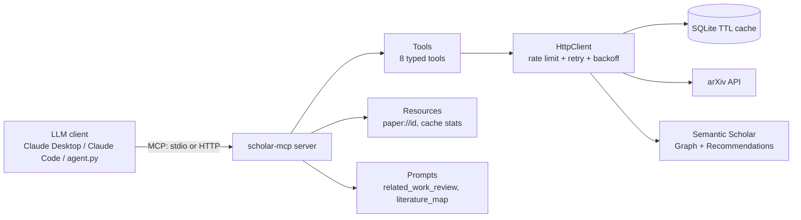

# scholar-mcp

[](https://github.com/raovivek02/scholar-mcp/actions/workflows/ci.yml)

An [MCP](https://modelcontextprotocol.io) server that gives LLM agents **grounded access to
academic literature**: paper search over arXiv and Semantic Scholar, citation graphs, related-paper
discovery, and BibTeX export, plus prompt templates that make the model write related-work
summaries *only from retrieved evidence*.

> **Design rule:** tools fetch and compute; the LLM reasons and writes. Search, graph
> construction, ranking and BibTeX happen in code (reproducible, testable). Summaries are written by
> the client model from tool output, guided by MCP prompts, so every claim traces back to a paper
> the server actually returned.

## Architecture



## Tools

| Tool | Purpose | Source |
|---|---|---|
| `search_papers` | Keyword search with year / min-citation filters, sortable by citations | Semantic Scholar |
| `search_arxiv` | Category-aware search; `sort_by="newest"` for fresh preprints | arXiv |
| `get_paper_details` | Full abstract, authors, venue, citation counts, links | Semantic Scholar |
| `get_citations` | Forward citations, optionally influential-only, ranked | Semantic Scholar |
| `get_references` | A paper's bibliography, ranked | Semantic Scholar |
| `find_related_papers` | Similar papers from a seed (recommendation model) | Semantic Scholar |
| `build_citation_graph` | Bounded BFS graph (depth 1-2); returns nodes, edges, `key_papers` ranked by in-graph citations | Semantic Scholar |
| `export_bibtex` | Deterministic BibTeX, per-paper failure reporting | Semantic Scholar |

**Resources:** `paper://{id}` (Markdown paper card), `scholar://cache/stats`.
**Prompts:** `related_work_review(topic, num_papers, year_from)`, `literature_map(seed_paper)`.

All tools are annotated read-only. Paper ids can be arXiv ids (`1706.03762`, `arXiv:...v3`, URLs),
DOIs, or Semantic Scholar ids; they are normalised automatically.

## Engineering notes

- **Typed schemas** via Pydantic `Field` constraints (`limit` 1-50, `depth` 1-2, ...); invalid calls
  are rejected by the protocol layer before any network call.
- **Rate limiting & resilience:** per-host throttling (arXiv 1 req / 3 s, Semantic Scholar 1 req / 1.6 s, safely under its 1 req/s key limit),
  retries with exponential backoff, honours `Retry-After`, distinct errors for 404 / 429 / 5xx.
- **Caching:** SQLite TTL cache (search 1 h, paper 24 h, citations 6 h) so agent loops don't burn quota.
- **LLM-readable errors:** failures say what went wrong and what to try next. Errors subclass the SDK's
  `ToolError`, because the SDK hides the text of unexpected exceptions from the client.
- **Bounded outputs:** abstracts trimmed in lists, graphs capped by nodes / per-node / per-level
  limits, with a `truncated` flag, so responses fit in a context window.
- **MCP SDK compatibility:** developed and tested on `mcp` 2.x (where `FastMCP` became `MCPServer`); a small import shim keeps 1.x working, but 1.x is not covered by CI.

## Quick start

```bash
git clone https://github.com/raovivek02/scholar-mcp.git && cd scholar-mcp
python -m venv .venv && source .venv/bin/activate
pip install -e ".[dev,agent]"
pytest -q                          # unit tests use mocked HTTP, no network needed
python scripts/live_smoke.py       # one-off check against the real APIs
mcp dev src/scholar_mcp/server.py  # opens the MCP Inspector (needs Node.js)
```

Optional but recommended: a free [Semantic Scholar API key](https://www.semanticscholar.org/product/api)
in `SEMANTIC_SCHOLAR_API_KEY` for reliable rate limits.

### Use it from Claude Desktop / Claude Code

Claude Desktop: copy `examples/claude_desktop_config.json` into your config and fix the path.
Claude Code: `claude mcp add scholar -- /path/to/.venv/bin/python -m scholar_mcp`

### Run it as an HTTP server

```bash
python -m scholar_mcp --transport streamable-http --host 127.0.0.1 --port 8000
```

### Run the agent loop

```bash
export ANTHROPIC_API_KEY=...
python client/agent.py "Write a related-work paragraph on LiDAR moving object segmentation"
```

No paid API? Use a free local model through Ollama (or any OpenAI-compatible endpoint such as Groq,
Gemini or OpenRouter):

```bash
ollama pull qwen2.5:32b            # or qwen2.5:7b on a smaller GPU
python client/agent_openai.py "Write a related-work paragraph on LiDAR moving object segmentation"
python eval/run_eval.py --provider openai --model qwen2.5:32b
```

Free hosted option: a Google AI Studio key (free tier) works through Gemini's OpenAI-compatible
endpoint - set `LLM_BASE_URL=https://generativelanguage.googleapis.com/v1beta/openai/`,
`LLM_API_KEY`, and `LLM_MODEL` (see the docstring in `client/agent_openai.py`).

`client/agent.py` connects over MCP, lists the tools, passes them to the model, executes tool calls
and loops until the model produces a final answer.

## Evaluation

`eval/run_eval.py` runs the agent on the questions in `eval/cases.json` and reports:

| Metric | Meaning |
|---|---|
| `tool_selection` | Required tools were called |
| `retrieval_recall` | Fraction of known key papers that appeared in tool output |
| `grounded` | Every arXiv id in the final answer was returned by a tool (no invented citations) |
| `citation_support` | Every "(Author et al., Year)" citation matches a paper a tool returned |
| `graceful_failure` | A nonexistent paper is reported as not found, not hallucinated |

```bash
python eval/run_eval.py --model claude-sonnet-5-5   # writes eval/results.md
```

Results (`eval/results.md`):

Model: `gemini-3.5-flash-lite` - 8 cases

| metric | score |
|---|---|
| tool_selection | 1.0 |
| retrieval_recall | 0.889 |
| grounded | 1.0 |
| citation_support | 1.0 |
| graceful_failure | 1.0 |

| case | tools ok | recall | grounded | turns |
|---|---|---|---|---|
| lookup-details | True | 1.0 | True | 3 |
| recent-preprints | True | None | True | 2 |
| forward-citations | True | None | True | 3 |
| foundations-graph | True | None | True | 3 |
| bibtex | True | 1.0 | True | 2 |
| related-work | True | 0.667 | True | 3 |
| similar-papers | True | None | True | 4 |
| missing-paper | True | None | True | 3 |

Single run on 8 hand-written queries (`eval/cases.json`). A small sample, so treat it as a smoke-level evaluation, not a benchmark.


## Example run

`python client/agent_openai.py "Write a short related-work paragraph on LiDAR moving object segmentation using 5 papers, with citations"` (Gemini 3.5 Flash-Lite)

Tool calls made by the agent:

```
[tool] search_papers({'limit': 5, 'min_citations': 20, 'sort_by': 'citations', 'query': 'LiDAR moving object segmentation'})
```

Final answer:

> Accurately segmenting moving objects from 3D LiDAR scans is a crucial capability for autonomous vehicles, enabling safe navigation, collision avoidance, and robust mapping (Chen et al., 2021; Mersch et al., 2022). Early learning-based approaches largely focused on leveraging sequential range images or point clouds to distinguish dynamic entities from static surroundings (Chen et al., 2021). To better capture geometric and temporal dependencies across consecutive frames, subsequent methods introduced sparse 4D convolutions (Mersch et al., 2022) and efficient spatial-temporal information fusion designs using dual-branch networks (Sun et al., 2022). More recent work has sought to improve computational efficiency and representational power through bird's-eye view (BEV) appearance and motion feature learning (Zhou et al., 2023), as well as by jointly modeling mutually reinforcing tasks such as scene flow estimation and moving object segmentation (Chen et al., 2024).

Every citation above matches a paper returned by that `search_papers` call.

## Configuration

| Variable | Purpose |
|---|---|
| `SEMANTIC_SCHOLAR_API_KEY` | Semantic Scholar key (strongly recommended) |
| `SCHOLAR_MCP_CACHE` | Cache file path (default `~/.cache/scholar-mcp/cache.sqlite`) |
| `ANTHROPIC_API_KEY`, `ANTHROPIC_MODEL` | For `client/agent.py` |
| `LLM_BASE_URL`, `LLM_MODEL`, `LLM_API_KEY` | For `client/agent_openai.py` (Ollama, Gemini, Groq, ...) |

## Project layout

```
src/scholar_mcp/   server.py (tools/resources/prompts) · semantic_scholar.py · arxiv_client.py
                   graph.py · bibtex.py · http.py · cache.py · ids.py · models.py · errors.py
client/agent.py    tool-calling agent loop      eval/    evaluation harness + cases
tests/             unit + stdio protocol tests  scripts/ live API smoke test
```

## Limitations

- Coverage and citation counts are whatever the two APIs return; Semantic Scholar's citation list is
  fetched in a 200-paper window, so very highly cited papers are sampled, not exhaustive.
- Citation graphs are bounded samples of top-cited neighbours, not complete networks.
- Abstracts only; full-text retrieval is not implemented.

- The evaluation is small: 8 hand-written queries, one run, one model (Gemini 3.5 Flash-Lite via its free tier).
- Semantic Scholar occasionally returns HTTP 429 even within the key's limit. The client retries with backoff (up to 5 times); a call that still fails reaches the model as a tool error it can react to (in one eval run the agent fell back to arXiv search).

## Roadmap

Full-text PDF extraction tool · OpenAlex as a third source · author-centric tools · Docker image +
auth for remote hosting.

## License

MIT
